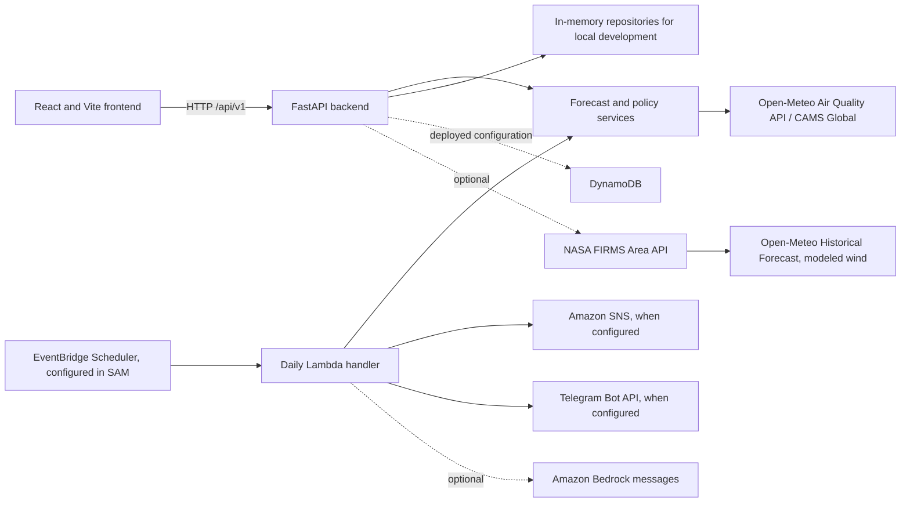

# School Air Alert

**Plan school activities with a forecast-based view of PM2.5.** School Air Alert
turns hourly air-quality forecasts into a simple GREEN / YELLOW / RED school
policy status, shows the hourly outlook, and helps staff compare outdoor time
windows. It is a decision-support tool: it is not a sensor network, an official
government AQI service, medical advice, or a guarantee that an activity is safe.

## Preview

Project screenshots have not yet been added. See
[`docs/screenshots/README.md`](docs/screenshots/README.md) for the screenshots
that would help visitors understand the dashboard, report, and poster. No
unrelated or illustrative image is presented as an application screenshot.

## What you can try

- View hourly PM2.5 forecast values, source and retrieval time, and a school
  decision-support status on the dashboard.
- Select or register a school and edit its coordinates.
- Compare best and worst forecast windows and read the general activity
  guidance supported by the current policy.
- View saved forecast history in the monthly report and create a printable
  notice poster.
- Switch between English, Hindi, and Marathi; choose light or dark appearance.
- Use the optional email subscription and Telegram features when their
  integrations are configured.
- View optional NASA FIRMS satellite detections with modeled wind context.
  This is not confirmation that smoke reaches a school.

The dashboard offers a clearly labelled demo mode. Live mode requests forecast
data from the backend and does not silently substitute demo values when an API
request fails.

## Try the demo

The local in-memory backend seeds a fictional `Demo School` at Mumbai example
coordinates (`19.0760`, `72.8777`). You can also register a fictional Pune
school with latitude `18.5590` and longitude `73.7868`. These are examples for
testing, not real school or sensor data. Start the local app using the
[quick start](#quick-start); choose demo mode for the illustrative dashboard,
or live mode to request Open-Meteo through the backend. Then try `/`, `/report`,
and `/poster?school_id=demo-school`.

## Architecture and technology



The frontend is JavaScript with React 18, Vite, React Router, Recharts, and
plain CSS. The backend uses Python 3.12, FastAPI, Pydantic, and Mangum. Backend
repositories can use temporary in-memory data locally or DynamoDB in the
configured AWS architecture. The SAM template and Amplify build configuration
describe a deployment path; this repository does not claim that AWS resources
or a production site are deployed or verified.

## Quick start

Prerequisites: Git, Python 3.12, Node.js 22.12 or newer, and npm. The commands
below use POSIX shell syntax (Linux and macOS, or WSL/Git Bash on Windows).
Windows PowerShell equivalents and detailed setup are in
[`docs/LOCAL_DEVELOPMENT.md`](docs/LOCAL_DEVELOPMENT.md).

Clone the project and start the backend in Terminal 1:

```sh
git clone https://github.com/rd-111/school-air-alert.git
cd school-air-alert/backend
python3.12 -m venv .venv
. .venv/bin/activate
python -m pip install -r requirements-dev.txt
export USE_MEMORY_DB=true
python -m uvicorn app.main:app --reload --port 8017
```

Start the frontend in Terminal 2 from the repository root:

```sh
cd school-air-alert/frontend
npm ci
npm run dev -- --port 5174
```

Open the local Vite URL, normally `http://localhost:5174`. The default
frontend mode is demo. To use the backend forecast, copy
`frontend/.env.example` to `frontend/.env`, set `VITE_DATA_MODE=live` and
`VITE_API_URL=http://localhost:8017`, then restart Vite. Backend settings are
read from process environment variables; a `backend/.env` file is not loaded
automatically. The local memory repository is temporary and is not production
storage.

## Environment variables

`frontend/.env.example` and `backend/.env.example` contain safe local examples
and placeholders. Backend settings must be exported into the process that
starts the API; Vite reads its `frontend/.env` values at build/dev-server start.

| Variable(s) | Purpose | Local / deployment |
|---|---|---|
| `VITE_DATA_MODE` | `demo` for illustrative browser data; `live` for backend requests | Local and frontend build; defaults to demo |
| `VITE_API_URL` | Backend API base URL, e.g. `http://localhost:8017` | Required for live frontend mode; set to the verified API URL for hosting |
| `VITE_TELEGRAM_BOT_USERNAME` | Public bot username used to form a link | Optional public frontend setting; never put a bot token here |
| `USE_MEMORY_DB` | Enables temporary local in-memory repositories | Set `true` for local backend; use configured DynamoDB, not memory, for persistent deployment |
| `CORS_ORIGINS` | Comma-separated exact browser origins | Local defaults are provided; add the exact deployed frontend origin for deployment |
| `AWS_REGION`, `SCHOOLS_TABLE`, `SUBSCRIBERS_TABLE`, `HISTORY_TABLE`, `NOTIFICATION_RUNS_TABLE` | AWS persistence, topic, and scheduled-job configuration | Deployment only; values depend on reviewed AWS resources |
| `FIRMS_MAP_KEY` | Optional NASA FIRMS credential | Only if enabling F20 live lookups; backend secret configuration only |
| `TELEGRAM_TOKEN`, `TELEGRAM_SECRET` | Bot API access and webhook authentication | Only for Telegram integration; backend/deployment secret configuration only |
| `BEDROCK_MODEL` | Optional message-generation model identifier | Optional deployment setting; requires approved model access/IAM and may incur cost |
| `FORECAST_CACHE_TTL_SECONDS`, `FIRMS_SEARCH_RADIUS_KM`, `FIRMS_CACHE_TTL_SECONDS` | Forecast caching and F20 search/cache settings | Optional backend tuning; defaults are defined in backend settings |
| `PM25_GREEN_MAX`, `PM25_YELLOW_MAX`, `PM25_SENSITIVE_GREEN_MAX`, `PM25_SENSITIVE_YELLOW_MAX` | Configurable prototype status bands | Optional backend configuration; defaults are prototype values, not official CPCB AQI categories |

Never put real secrets into `.env.example`, frontend `VITE_` values, source,
issues, or screenshots. The backend example lists the currently supported
settings and placeholder values; it is not loaded automatically.

## Data, policy, and safety

- PM2.5 forecasts come from the Open-Meteo Air Quality API using CAMS Global.
  These are model forecasts, not measurements at a school. The backend reports
  source and retrieval metadata. Open-Meteo's free API has usage terms, requires
  CC BY 4.0 attribution, and is limited to non-commercial use; review its
  [API documentation](https://open-meteo.com/en/docs/air-quality-api) and
  [terms](https://open-meteo.com/en/terms) before use.
- GREEN / YELLOW / RED bands are configurable prototype school-policy limits
  in µg/m³. They are not official CPCB AQI categories. See
  [`docs/thresholds.md`](docs/thresholds.md).
- Historical forecast accuracy is not calculated. The project has not approved
  an authoritative observation dataset or matching method.
- F20 may show nearby NASA FIRMS detections with Open-Meteo modeled wind. A
  FIRMS MAP_KEY is optional and backend-only (`FIRMS_MAP_KEY`). Satellite
  detections and modeled wind do not confirm smoke exposure; the causal smoke
  attribution sentence remains blocked. See the [NASA FIRMS API information](https://firms.modaps.eosdis.nasa.gov/api/).
- Email, Telegram, scheduled notifications, and AWS persistence depend on
  external configuration. Local tests and code do not verify real delivery.
- **Informational only, not medical advice.** Decisions remain with school
  staff and their applicable policies.

## API and developer references

FastAPI interactive documentation is available locally at
[`http://localhost:8017/docs`](http://localhost:8017/docs); the OpenAPI schema
is at `/openapi.json`. Main routes include:

| Method | Route | Purpose |
|---|---|---|
| `GET` | `/api/v1/health` | API health |
| `GET` | `/api/v1/forecast?latitude=…&longitude=…` | Hourly forecast for coordinates |
| `GET`, `POST` | `/api/v1/schools` | List and register schools |
| `POST` | `/api/v1/subscribe` | Request an email subscription |
| `GET` | `/api/v1/status?school_id=…` | Current school status |
| `GET` | `/api/v1/history?school_id=…&days=30` | Saved forecast history |
| `GET` | `/api/v1/schools/{school_id}/smoke-hint` | Optional F20 context |
| `POST` | `/api/v1/telegram` | Secret-header-protected Telegram webhook |

See [`docs/architecture.md`](docs/architecture.md),
[`docs/FEATURES.md`](docs/FEATURES.md),
[`docs/LIVE_TESTING_GUIDE.md`](docs/LIVE_TESTING_GUIDE.md), and
[`docs/DEPLOYMENT.md`](docs/DEPLOYMENT.md) for architecture, feature status,
manual checks, and deployment instructions.

## Tests and checks

Run the backend checks from `backend/`:

```sh
python -m pytest -q
ruff check .
```

Run frontend checks from `frontend/`:

```sh
npm ci
npm test -- --run
npm run build
```

Tests use local fixtures and mocks; they should not require AWS credentials or
NASA FIRMS keys. A previous recorded local run in the project status notes
reported 143 backend tests and 36 frontend tests passing, with Ruff and the
frontend build passing. These results were not rerun for this documentation
change and do not establish live-provider, remote CI, or deployment behavior.
An intermittent synchronous Starlette TestClient/AnyIO hang has also been
observed; its cause remains unknown. If it recurs, see the live testing guide
and preserve the failing test rather than skipping it.

## Status and roadmap

- **Implemented locally:** F1–F18 application paths, including forecast,
  classification, activity windows, school/status/history APIs, dashboard,
  report, poster, and optional integration code. Automated tests and mocks are
  present; live email/Telegram and AWS behavior are not thereby verified.
- **Implemented locally, external verification pending:** F20 optional FIRMS
  detections plus modeled wind context; F21 evening forecast processing and
  schedule configuration. The corresponding live providers and deployed AWS
  schedules/delivery remain unverified.
- **Blocked / planned:** F19 forecast accuracy comparison awaits an approved
  observation source and comparison rules. The original causal F20 smoke
  attribution remains blocked. See
  [`docs/pending-decisions.md`](docs/pending-decisions.md).

Feature-by-feature status is maintained in
[`docs/FEATURES.md`](docs/FEATURES.md); this summary does not imply production
deployment or successful notification delivery.

## Contributing, license, and acknowledgements

First-time contributors can start with [`CONTRIBUTING.md`](CONTRIBUTING.md).
There is currently no repository license file, so no reuse or redistribution
license is declared. Open-Meteo and CAMS data are attributed by the application;
review the provider's current terms. NASA FIRMS data is identified as satellite
detection context. School Air Alert is not officially affiliated with those
providers.
