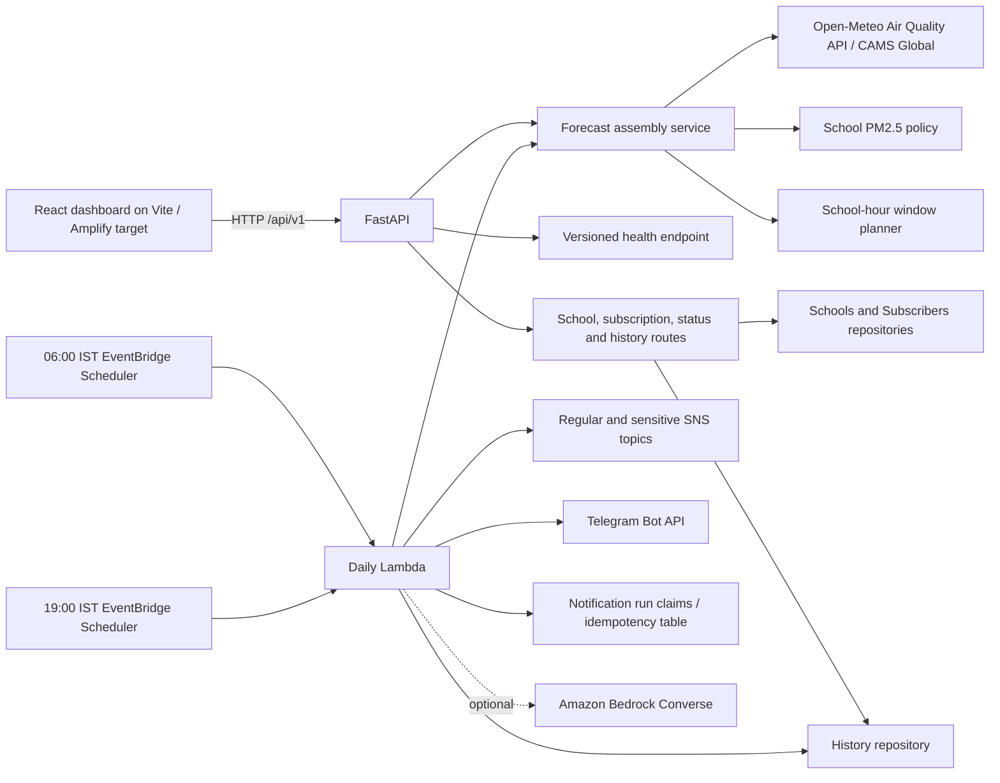

# Architecture

The 19:00 schedule requests the next local calendar day's forecast with a
two-day provider horizon. The scheduled timestamp anchors its target date across
retries. Notification claims reduce duplicate delivery; live scheduler and
SNS/Telegram behavior have not been deployed or verified. F19 observed-data
comparison and F20 fire-source hints are absent pending data-source and policy
decisions.

The browser's API client has explicit demo and live modes. The live API returns
forecast provenance and retrieval time; it does not label forecast values as
measurements. FastAPI is wrapped by the existing Mangum handler, but AWS SAM
infrastructure and deployment have not been verified.
